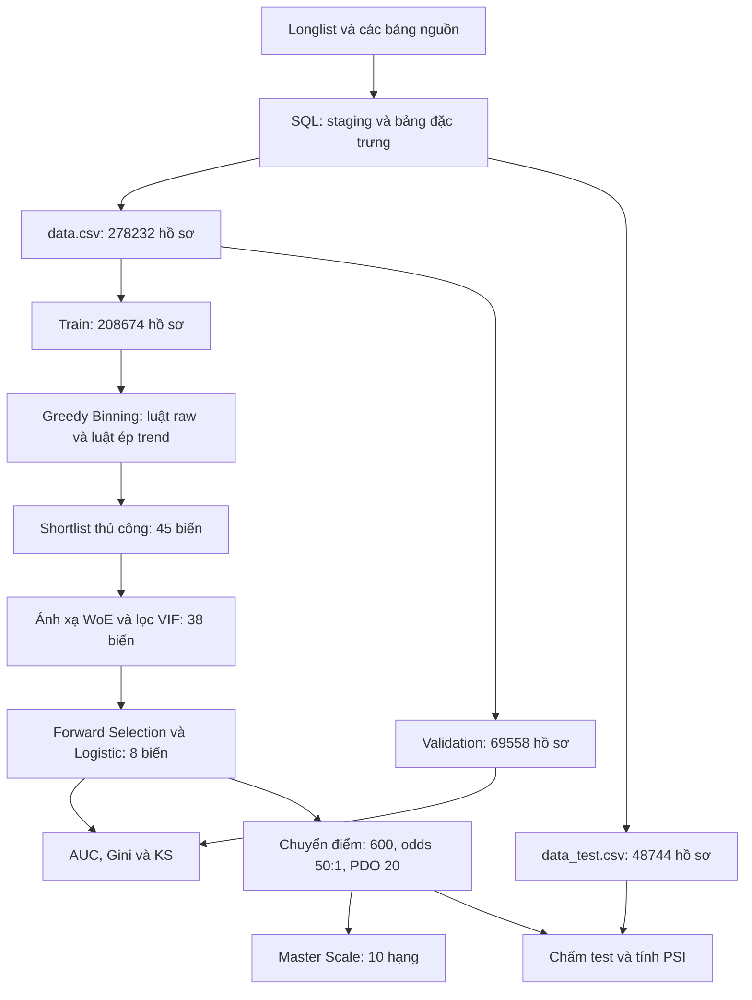
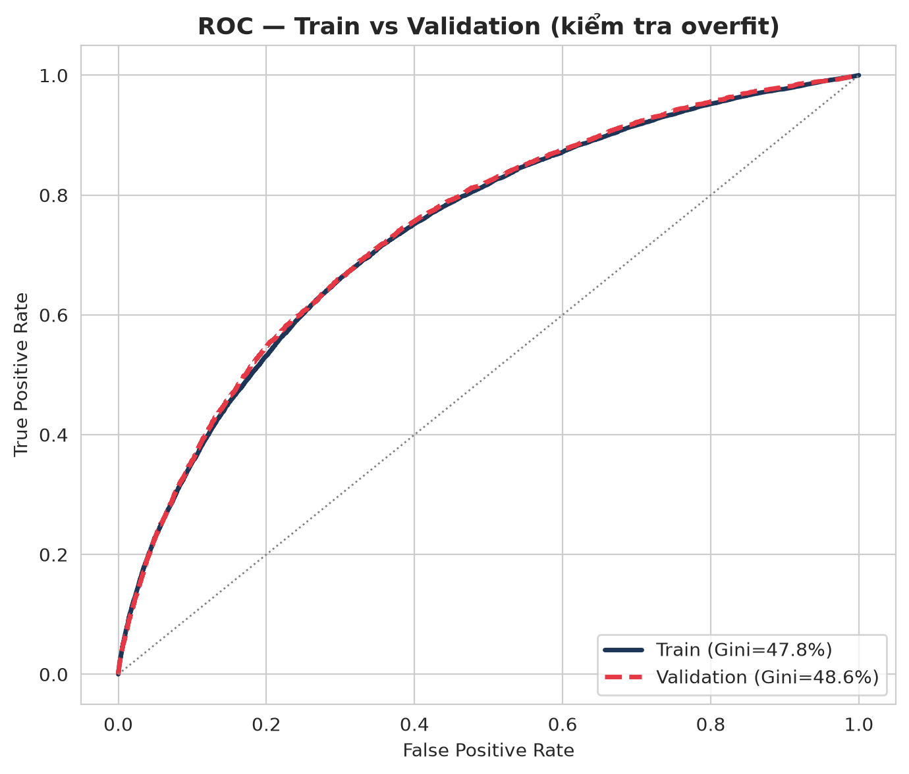
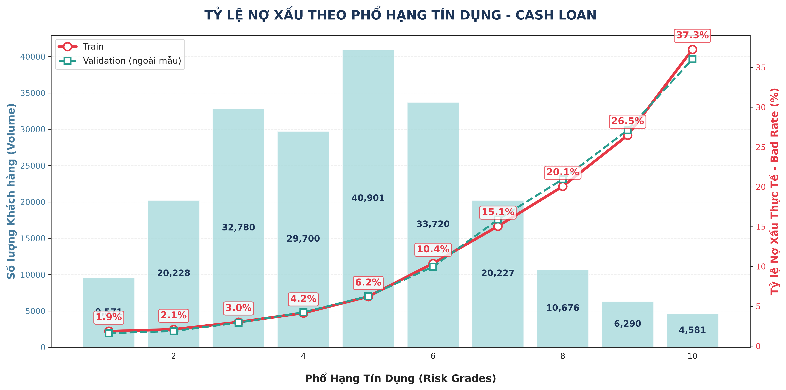
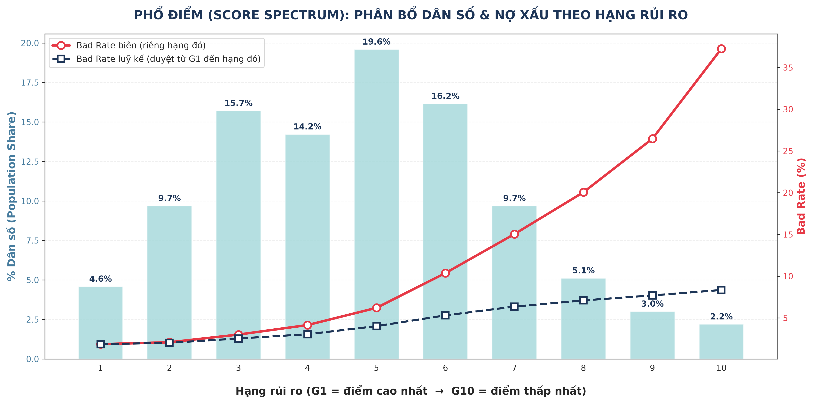

# Xây dựng mô hình Credit Scorecard bằng SQL và Python

Dự án xây dựng thẻ điểm tín dụng theo quy trình: **Longlist → Feature Engineering → Làm sạch dữ liệu → Greedy Binning, WoE và IV → Logistic Regression và chọn biến → Kiểm định → Chuyển đổi thang điểm → Xếp hạng rủi ro**.

Mô hình sử dụng thông tin hồ sơ, lịch sử tín dụng bên ngoài, hồ sơ vay trước, trả góp, POS/Cash và thẻ tín dụng để ước lượng xác suất `TARGET = 1`. Kết quả được chuyển thành điểm số và 10 hạng rủi ro; **điểm càng cao, rủi ro dự báo càng thấp; G1 là hạng tốt nhất, G10 là hạng rủi ro cao nhất**.

Phương pháp hiện tại giữ nguyên cơ cấu good/bad của dữ liệu: **không SMOTE, không tăng/giảm mẫu để cân bằng lớp, không loại khách hàng bằng thuật toán phát hiện anomaly**. Missing và mã đặc biệt được xử lý trong thiết kế biến, binning và ánh xạ WoE.

README được lập ngày **05/09/2026**, dựa trên toàn bộ **13 file SQL, 3 notebook, 7 file Excel, 11 file CSV và 8 biểu đồ PNG** có trong thư mục trước khi bổ sung tài liệu này. Phần Python nằm trong các notebook `.ipynb`; dự án chưa có module `.py` riêng. Các số liệu bên dưới được đối chiếu với dữ liệu và kết quả đã lưu.

> **Trạng thái kết quả:** mô hình 8 biến có kết quả phân biệt train/validation gần nhau. Tuy nhiên, phiên bản hiện tại còn lệch nguồn luật `LTV_RATIO` giữa huấn luyện và notebook thang điểm; 14 biến Cross trong test đều thiếu; hạng test được chia lại bằng phân vị riêng. Các báo cáo điểm, hạng và PSI cần được đọc cùng [phần vấn đề đã phát hiện](#van-de). README ghi nhận hiện trạng; các file SQL, notebook và kết quả gốc chưa được sửa.

## Mục lục

- [Tổng quan thư mục và dữ liệu](#tong-quan)
- [Bước 1 — Thiết kế Features: Longlist](#buoc-1)
- [Bước 2 — Feature Engineering bằng SQL](#buoc-2)
- [Bước 3 — Làm sạch dữ liệu và chia mẫu kiểm định](#buoc-3)
- [Bước 4 — Phân tích đơn biến: Greedy Binning, WoE, IV](#buoc-4)
- [Bước 5 — Phân tích đa biến: VIF và Logistic Regression](#buoc-5)
- [Bước 6 — Kiểm định mô hình](#buoc-6)
- [Bước 7 — Chuyển đổi thang điểm](#buoc-7)
- [Bước 8 — Chuyển đổi ra hạng và xem xét điểm cắt](#buoc-8)
- [Danh mục kết quả đầu ra](#dau-ra)
- [Hướng dẫn chạy lại](#chay-lai)
- [Các vấn đề đã phát hiện và ảnh hưởng đến kết quả](#van-de)
- [Phạm vi đối chiếu và các phần chưa có](#doi-chieu)

<a id="tong-quan"></a>

## Tổng quan thư mục và dữ liệu

### Cấu trúc dự án

```text
scorecard/
├── README.md
├── Longlist.xlsx
├── Shortlist.xlsx
├── SQL/                            # Tạo staging và bảng đặc trưng
│   ├── STG_BASE_APP.sql
│   ├── STG_TEST_APP.sql
│   ├── STG_BUREAU.sql
│   ├── STG_BUREAU_DPD.sql
│   ├── STG_PREV_APP.sql
│   ├── STG_INST_AGG.sql
│   ├── STG_POS_CASH.sql
│   ├── STG_CREDIT_CARD .sql          # Có dấu cách trước .sql
│   ├── STG_CROSS.sql
│   ├── FEATURE_FINAL.sql
│   ├── FEATURE_TEST_FINAL.sql
│   ├── Cash loans.sql
│   └── test.sql
├── DATA/
│   ├── data.csv                    # Dữ liệu phát triển có TARGET
│   └── data_test.csv               # Dữ liệu test không có nhãn
├── Phan_tich_don_bien.ipynb
├── Phan tich da bien.ipynb
├── Chuyen doi thang diem.ipynb
└── output/                         # Dữ liệu trung gian, Excel và biểu đồ
```

### Mục tiêu, đơn vị quan sát và nhãn

Các tên bảng và mô tả trong Longlist thuộc bài toán Home Credit. Mỗi dòng trong dữ liệu mô hình tương ứng một `SK_ID_CURR`; trường này dùng để định danh và nối dữ liệu, không tham gia hồi quy.

| Trường | Ý nghĩa trong dự án |
|---|---|
| `SK_ID_CURR` | Mã hồ sơ/khách hàng tại bảng application; khóa nối các bảng tổng hợp |
| `SK_ID_BUREAU` | Khóa nối `bureau_balance` với `bureau` trước khi tổng hợp về `SK_ID_CURR` |
| `TARGET = 0` | Good theo nhãn dữ liệu nguồn |
| `TARGET = 1` | Bad/khó khăn trả nợ theo nhãn dữ liệu nguồn |
| `TARGET` trong `submission.csv` | **Xác suất dự báo**, không phải nhãn thực tế |

Thư mục chưa chứa đặc tả đầy đủ về cửa sổ quan sát, cửa sổ hiệu suất hoặc định nghĩa bad theo số ngày quá hạn. Vì vậy không mặc định diễn giải `TARGET` thành một định nghĩa cụ thể như “90+ DPD trong 12 tháng”.

[SQL/Cash loans.sql](<SQL/Cash loans.sql>) lọc `NAME_CONTRACT_TYPE = 'Cash loans'`, và biểu đồ phổ hạng ghi Cash Loan. Đây là phạm vi sản phẩm dự kiến của dữ liệu phát triển. Tuy nhiên, CSV không giữ `NAME_CONTRACT_TYPE`, database nguồn và nhật ký export không nằm trong thư mục, nên chưa thể xác minh lại từng hồ sơ thuộc sản phẩm nào. Nhánh SQL test hiện không có điều kiện lọc Cash loans.

### Quy mô dữ liệu thực tế

| Tập | File | Số dòng | Số cột | Good | Bad | Bad rate |
|---|---|---:|---:|---:|---:|---:|
| Phát triển, trước chia tập | [data.csv](DATA/data.csv) | 278.232 | 127 | 255.011 | 23.221 | 8,3459% |
| Train | [0.data_train_split.csv](output/0.data_train_split.csv) | 208.674 | 127 | 191.258 | 17.416 | 8,3460% |
| Validation | [0.data_valid_split.csv](output/0.data_valid_split.csv) | 69.558 | 127 | 63.753 | 5.805 | 8,3456% |
| Test chưa có nhãn | [data_test.csv](DATA/data_test.csv) | 48.744 | 126 | — | — | Không tính được |

Các file đầu vào và split không có `SK_ID_CURR` trùng trong từng file. Train và validation không giao nhau; hợp hai tập đúng bằng tập phát triển. Test không giao ID với tập phát triển.

### Luồng xử lý và thu hẹp danh sách biến



Sơ đồ thể hiện quan hệ các bước. Việc tái sử dụng luật và ngưỡng giữa các nhánh hiện còn các khác biệt được nêu ở [phần vấn đề](#van-de).

| Mốc | Quy mô | Giải thích |
|---|---:|---|
| Longlist/bảng dữ liệu phát triển | 127 cột | Bao gồm ID và TARGET |
| Ứng viên đưa vào binning | 125 biến | Bỏ ID và TARGET |
| Biến có báo cáo binning | 124 biến | `employed_to_age_ratio` chỉ có một giá trị không thiếu nên bị bỏ qua |
| Shortlist | 45 biến | 39 dùng luật raw, 6 dùng luật ép trend |
| Sau VIF | 38 biến | Loại 7 biến theo ngưỡng VIF = 5 |
| Mô hình cuối | 8 biến | Chọn tiến theo Gini train |

<a id="buoc-1"></a>

## Bước 1 — Thiết kế Features: Longlist

Tài liệu thiết kế nằm trong [Longlist.xlsx](Longlist.xlsx): sheet `Tổng hợp` thống kê nhóm biến; sheet `Danh sách biến` có 127 dòng, gồm tên biến, bảng nguồn, kiểu dữ liệu, công thức, ý nghĩa nghiệp vụ, kỳ vọng rủi ro và ghi chú.

| Nhóm | Số cột | Nội dung và ví dụ |
|---|---:|---|
| 00. Định danh và nhãn | 2 | `SK_ID_CURR`, `TARGET` |
| 01. Nhân khẩu học và hồ sơ | 16 | Giới tính, sở hữu tài sản, số con, thu nhập, khoản vay, tuổi, thâm niên |
| 02. Điểm nguồn ngoài | 4 | `EXT_SOURCE_1`, `EXT_SOURCE_2`, `EXT_SOURCE_3`, `EXT_SOURCE_AVG` |
| 03. Tỷ lệ hồ sơ gốc | 9 | Khoản vay/thu nhập, trả góp/thu nhập, kỳ hạn proxy, hàng hóa/khoản vay |
| 04. Bureau | 16 | Số khoản, khoản active/closed, tổng nợ, quá hạn, mở mới theo cửa sổ |
| 05. Bureau Balance | 7 | Bản ghi trạng thái C/X và số bản ghi quá hạn trong 3/6/9/12/24 tháng |
| 06. Installments | 16 | Trả trễ, trả sớm, trả thiếu, số tiền phải trả và đã trả |
| 07. Previous Application | 17 | Hồ sơ duyệt/từ chối/hủy, cơ cấu sản phẩm, lịch sử quyết định |
| 08. POS/Cash Balance | 12 | Số bản ghi, DPD, trạng thái active/completed |
| 09. Credit Card Balance | 14 | Dư nợ, hạn mức, sử dụng thẻ, rút ATM, DPD |
| 10. Cross | 14 | Các tỷ lệ kết hợp từ hồ sơ và bảng tổng hợp lịch sử |
| **Tổng** | **127** | **125 biến đầu vào tiềm năng và 2 cột định danh/nhãn** |

Kỳ vọng rủi ro trong Longlist là giả thuyết để kiểm tra bằng dữ liệu. Quyết định giữ biến còn phụ thuộc IV, hình dạng bad rate, mức missing, tương quan, đóng góp khi kết hợp và khả năng giải thích. Chẳng hạn, `LTV_RATIO` có bad rate hình chữ U ở bảng raw và được chọn dùng bảng ép trend khi huấn luyện.

Một số tên trong Excel viết thường như `age_years`, `ltv_ratio`; SQL/CSV sử dụng `AGE_YEARS`, `LTV_RATIO`. Khi khai báo danh sách biến trong Python phải dùng đúng tên cột thực tế.

<a id="buoc-2"></a>

## Bước 2 — Feature Engineering bằng SQL

### Nguồn dữ liệu và vai trò của từng file

Các bảng nguồn cần có trong database: `application_train`, `application_test`, `bureau`, `bureau_balance`, `previous_application`, `installments_payments`, `POS_CASH_balance` và `credit_card_balance`. Các bảng/file dữ liệu nguồn này chưa được lưu trong repository; `DATA/` chứa bảng đặc trưng đã export.

| SQL | Nguồn/phụ thuộc | Kết quả và logic chính |
|---|---|---|
| [STG_BASE_APP.sql](SQL/STG_BASE_APP.sql) | `application_train` | Hồ sơ train, TARGET, tuổi/thâm niên, điểm ngoài trung bình và tỷ lệ hồ sơ |
| [STG_TEST_APP.sql](SQL/STG_TEST_APP.sql) | `application_test` | Nhánh hồ sơ test, không lấy TARGET |
| [STG_BUREAU.sql](SQL/STG_BUREAU.sql) | `bureau` | Tổng hợp khoản tín dụng bên ngoài theo `SK_ID_CURR` |
| [STG_BUREAU_DPD.sql](SQL/STG_BUREAU_DPD.sql) | `bureau_balance` nối `bureau` | Đếm trạng thái/quá hạn, sau đó tổng hợp về `SK_ID_CURR` |
| [STG_PREV_APP.sql](SQL/STG_PREV_APP.sql) | `previous_application` | Tổng hợp số hồ sơ, trạng thái, số tiền và thời gian quyết định |
| [STG_INST_AGG.sql](SQL/STG_INST_AGG.sql) | `installments_payments` | Thống kê chênh ngày thanh toán, trả thiếu và tổng số tiền |
| [STG_POS_CASH.sql](SQL/STG_POS_CASH.sql) | `POS_CASH_balance` | Thống kê DPD, số bản ghi và trạng thái khoản vay |
| [STG_CREDIT_CARD .sql](<SQL/STG_CREDIT_CARD .sql>) | `credit_card_balance` | Thống kê dư nợ, sử dụng hạn mức, giao dịch và quá hạn thẻ |
| [STG_CROSS.sql](SQL/STG_CROSS.sql) | `application_train` và các staging lịch sử | Tạo 14 biến tỷ lệ; hiện chỉ có nhánh khách hàng train |
| [FEATURE_FINAL.sql](SQL/FEATURE_FINAL.sql) | `STG_BASE_APP` và các staging | `LEFT JOIN` về hồ sơ train, chuẩn hóa chuỗi rỗng và ép kiểu; 127 cột |
| [FEATURE_TEST_FINAL.sql](SQL/FEATURE_TEST_FINAL.sql) | `STG_TEST_APP` và các staging | Bảng test 126 cột, vẫn nối cùng `STG_CROSS` |
| [Cash loans.sql](<SQL/Cash loans.sql>) | `FEATURE_FINAL` nối `application_train` | Chọn hồ sơ Cash loans để export |
| [test.sql](SQL/test.sql) | `FEATURE_TEST_FINAL` | Truy vấn toàn bộ bảng đặc trưng test để export |

Các bảng lịch sử được tổng hợp trước, rồi `LEFT JOIN` theo `SK_ID_CURR`. Cách này giữ lại hồ sơ không có lịch sử ở một nguồn; các đặc trưng không nối được sẽ là missing.

### Công thức đáng chú ý

| Biến | Công thức/logic trong SQL hiện tại | Cách hiểu |
|---|---|---|
| `AGE_YEARS` | `-DAYS_BIRTH / 365` | Tuổi tính theo năm; CSV hiện chỉ có giá trị nguyên |
| `EMPLOYED_YEARS` | `CASE WHEN DAYS_EMPLOYED = 365243 THEN NULL ELSE -DAYS_EMPLOYED / 365 END` | Chuyển mã quy ước thành missing trong biến dẫn xuất |
| `flag_days_employed_anom` | 1 nếu `DAYS_EMPLOYED = 365243`, ngược lại 0 | Giữ thông tin nhóm có mã thâm niên đặc biệt |
| `EXT_SOURCE_AVG` | Tổng các điểm ngoài không thiếu / số nguồn không thiếu | Không biến một nguồn thiếu thành điểm 0 trong mẫu số |
| `CREDIT_INCOME_RATIO` | `AMT_CREDIT / AMT_INCOME_TOTAL` | Quy mô khoản vay so với thu nhập |
| `ANNUITY_INCOME_RATIO` | `AMT_ANNUITY / AMT_INCOME_TOTAL` | Nghĩa vụ trả góp so với thu nhập |
| `CREDIT_TERM_PROXY` | `AMT_CREDIT / AMT_ANNUITY` | Proxy về số kỳ, chưa phải kỳ hạn hợp đồng thực tế |
| `ANNUITY_CREDIT_RATIO` | `AMT_ANNUITY / AMT_CREDIT` | Nghịch đảo của proxy trên khi cả hai xác định |
| `LTV_RATIO` | **`AMT_GOODS_PRICE / AMT_CREDIT`** | Giá trị hàng hóa trên khoản vay; cần đọc đúng chiều công thức đang dùng |
| `bureau_debt_ratio` | `SUM(AMT_CREDIT_SUM_DEBT) / SUM(AMT_CREDIT_SUM)` | Dư nợ trên tổng giá trị tín dụng ghi nhận |
| `prev_app_credit_ratio` | `AVG(AMT_CREDIT / AMT_APPLICATION)` | Trung bình tỷ lệ cấp tín dụng trên số tiền xin vay tại các bản ghi có mẫu số hợp lệ |
| `total_inst_prescribed` | `SUM(AMT_INSTALMENT)` | Tổng tiền phải trả trên các bản ghi trả góp |
| `total_pay_ratio` | `SUM(AMT_PAYMENT) / SUM(AMT_INSTALMENT)` | Tổng thực trả trên tổng phải trả |
| `refusal_rate` | `refused_cnt / prev_app_cnt` | Tỷ lệ hồ sơ bị từ chối trong lịch sử |
| `late_ratio_12m` | `late_12m / inst_cnt_12m` | Tỷ lệ bản ghi thanh toán trễ trong cửa sổ đang xét |
| `cc_util_12m` | `AVG(CASE WHEN MONTHS_BALANCE >= -12 THEN AMT_BALANCE / NULLIF(AMT_CREDIT_LIMIT_ACTUAL, 0) ELSE 0 END)` | Bản ghi ngoài cửa sổ được đưa vào trung bình với giá trị 0; khác với chỉ lấy trung bình các bản ghi 12 tháng |

SQL dùng `NULLIF(mẫu_số, 0)` để tránh chia cho 0. Với `EXT_SOURCE_AVG`, nếu cả ba nguồn đều thiếu thì kết quả cũng thiếu.

Các cửa sổ ngày dùng mốc `-90`, `-180`, `-270`, `-360`; cửa sổ tháng dùng `MONTHS_BALANCE >= -3/-6/-9/-12/-24`. Đây là điều kiện thực tế trong code, chưa có bộ lọc ngày chốt dữ liệu riêng.

Những biến đếm DPD theo tháng đang đếm **bản ghi khoản vay–tháng**; nhiều khoản vay có thể cùng xuất hiện trong một tháng. Tương tự, các biến installments đếm/tổng hợp theo dòng nguồn, chưa thấy bước gộp các lần trả vào một kỳ thanh toán duy nhất. Vì vậy không mặc định mọi biến đếm đều là số tháng hoặc số kỳ duy nhất.

### Thứ tự dựng bảng

1. Chuẩn bị 8 bảng nguồn với tên cột và kiểu dữ liệu đã kiểm tra.
2. Tạo `STG_BASE_APP`, `STG_TEST_APP` và các staging lịch sử. Riêng `STG_BUREAU_DPD` cần cả `bureau_balance` và `bureau`.
3. Tạo các biến Cross sau khi có staging lịch sử; nhánh test cần được bổ sung phạm vi khách hàng tương ứng.
4. Tạo `FEATURE_FINAL` và `FEATURE_TEST_FINAL`.
5. Chạy truy vấn Cash loans để lấy dữ liệu phát triển; kiểm tra và thống nhất phạm vi sản phẩm của test trước khi export.
6. Export CSV có header vào `DATA/data.csv` và `DATA/data_test.csv`.

Các câu lệnh hiện dùng `CREATE TABLE ... AS`, chưa có script điều phối hoặc cơ chế chạy lại an toàn trên bảng đã tồn tại. Một số lệnh tạo index mới nằm trong comment. Xem [hướng dẫn chạy lại](#chay-lai) và [các điểm SQL cần đồng bộ](#van-de) trước khi dựng từ nguồn.

<a id="buoc-3"></a>

## Bước 3 — Làm sạch dữ liệu và chia mẫu kiểm định

Phần làm sạch được phân bố giữa SQL và [Phan_tich_don_bien.ipynb](Phan_tich_don_bien.ipynb), chưa có notebook làm sạch độc lập.

### Các xử lý đã có

| Vấn đề | Xử lý hiện tại |
|---|---|
| Chuỗi có khoảng trắng/chuỗi rỗng khi tạo bảng cuối | `TRIM`, `NULLIF(..., '')`, sau đó `CAST` sang `INTEGER` hoặc `REAL` |
| Mẫu số bằng 0 | Trả `NULL` bằng `NULLIF` |
| Mã `DAYS_EMPLOYED = 365243` | Tạo cờ và cho `EMPLOYED_YEARS` thành missing; giữ dòng khách hàng và cột gốc |
| Thiếu lịch sử từ bảng vệ tinh | Giữ missing qua `LEFT JOIN` |
| Missing khi binning | Tạo bin `Missing` với bad rate, WoE, IV riêng nếu có quan sát |
| Mã số đặc biệt khi binning | Tách `999999999999` và `-999999999999` thành một nhóm đặc biệt |
| Biến có tối đa một giá trị không thiếu | Bỏ qua trong `bin_variable` |
| Ô chưa ánh xạ được sau chuyển WoE | `fillna(0)` trên **dữ liệu WoE**, tạo đóng góp trung lập vào logit |

`fillna(0)` sau WoE khác với điền 0 vào đặc trưng gốc. Nếu train có bin `Missing`, khách thiếu dữ liệu nhận WoE của bin đó trước; chỉ các ô còn chưa có luật khớp mới rơi về 0.

Không có bước chuẩn hóa z-score/min-max, winsorization, loại outlier theo IQR, SMOTE, undersampling hoặc oversampling. `LogisticRegression` cũng không đặt `class_weight='balanced'`. Việc gộp bin là gộp nhóm giá trị, không xóa khách hàng.

### Chia train/validation trước khi học bin

```python
df_train, df_valid = train_test_split(
    df,
    test_size=0.25,
    stratify=df["TARGET"],
    random_state=42,
)
```

Sau khi lưu hai file split, notebook gán `df = df_train.copy()` rồi mới binning. Đây là chia tập phục vụ kiểm định, giữ gần như nguyên tỷ lệ good/bad; không phải tái lấy mẫu để cân bằng lớp.

Luật binning, WoE, IV, VIF, lựa chọn biến và hệ số được học từ train. Validation ở notebook đa biến được biến đổi bằng luật đã chọn từ train và chấm bằng mô hình đã fit. Chia tập hiện là ngẫu nhiên có phân tầng theo TARGET, chưa phải kiểm định theo thời gian.

### Đặc điểm chất lượng dữ liệu đã đối chiếu

- `data.csv` có 52.008 dòng mang mã `DAYS_EMPLOYED = 365243`; các dòng này vẫn được giữ lại trong dữ liệu phát triển.
- Không tìm thấy giá trị số vô cực hoặc hai mã `±999999999999` trong hai CSV đầu vào hiện tại. Nhánh special đã được viết nhưng không phát sinh quan sát trong lần dữ liệu này.
- `employed_to_age_ratio` chỉ bằng 0 ở phần không thiếu; do đó không tạo báo cáo binning.
- Missing trên dữ liệu phát triển khá cao ở nhóm thẻ: `cc_total_atm_drawn` khoảng 78,38%, `cc_avg_utilization` 69,58%, `cc_util_12m` 69,53%.
- Riêng test, **cả 14 biến Cross thiếu 100%**. Đây là vấn đề tạo dữ liệu cần phân biệt với khách hàng thực sự không có lịch sử.

<a id="buoc-4"></a>

## Bước 4 — Phân tích đơn biến: Greedy Binning, WoE và IV

Đây là bước xử lý và chuyển đổi dữ liệu trọng tâm, nằm trong [Phan_tich_don_bien.ipynb](Phan_tich_don_bien.ipynb). Notebook tự triển khai greedy merging bằng pandas/numpy; **không import hoặc gọi thư viện `optbinning`** dù phần diễn giải có nhắc đến thư viện này để so sánh ý tưởng.

### 4.1. Fine classing và coarse classing

Quy trình cho một biến số:

1. Tách phần missing và mã special ra khỏi phần giá trị thông thường.
2. Chia mịn bằng `pd.qcut(..., q=40, duplicates='drop')`; nếu lỗi thì thử `pd.cut(..., bins=40)`.
3. Tính số good, bad, total, bad rate và tỷ trọng của từng bin.
4. Gộp các bin liền kề theo độ giống nhau của bad rate.
5. Giữ bảng sau greedy làm phương án **raw**.
6. Từ bảng raw, chạy thêm gộp vi phạm trend để tạo phương án **ép trend**.
7. Mở hai đầu khoảng số ra `-inf` và `inf`, nối bin Missing/Special, tính WoE và IV.

Với cột dạng chữ hoặc cột có không quá hai giá trị không thiếu, code đi theo nhánh categorical: nhóm theo giá trị và gộp những giá trị có tỷ trọng nhỏ hơn 5% toàn bộ train vào `OTHERS`.

### 4.2. Cấu hình hiện tại

| Tham số | Giá trị | Vai trò |
|---|---:|---|
| `MAX_PREBINS` | 40 | Số phân vị chia mịn yêu cầu; thực tế có thể ít hơn do trùng giá trị |
| `MIN_FINAL_BINS` | 3 | Sàn dừng gộp cho bin số thông thường |
| `MAX_FINAL_BINS` | 5 | Số bin số thông thường mục tiêu tối đa |
| `BASE_MIN_BIN_SIZE` | 0.05 | Tỷ trọng bin mục tiêu tối thiểu |
| `BASE_MAX_BIN_SIZE` | 0.70 | Trần tỷ trọng khi chọn cặp gộp thông thường |
| `MIN_EVENT_RATE_DIFF` | 0.005 | Chênh bad rate mục tiêu tối thiểu giữa hai bin kề, tương đương 0,5 điểm phần trăm |
| `EPS` | `1e-6` | Cộng vào phân phối good/bad khi tính log WoE |
| `SPECIAL_VALUES` | `±999999999999` | Hai mã cùng được gom vào một nhóm đặc biệt |

Mẫu số của tỷ trọng bin là **toàn bộ số hồ sơ train, gồm cả missing/special**. Các ngưỡng này là cấu hình của dự án, không phải điều kiện được thuật toán bảo đảm tuyệt đối:

- Khi còn bin mỏng, ưu tiên gộp bin mỏng nhất với hàng xóm có bad rate gần nhất; nhánh này cho phép vượt trần 70%.
- Khi không có bin mỏng, chọn cặp chênh bad rate nhỏ nhất trong các cặp không làm tỷ trọng vượt trần.
- Dừng khi chạm sàn 3 bin hoặc không còn cặp hợp lệ, dù có điều kiện khác chưa đạt.
- Bước ép trend dừng ở sàn 3 bin và không kiểm tra lại trần dân số; do đó sheet “ép” vẫn có thể còn biến không đơn điệu.
- Với số giá trị khác nhau thấp, fine classing có thể đã tạo ít hơn 3 bin. Missing, special và categorical cũng không tuân theo khung 3–5 bin số.

### 4.3. Hai phương án trend

| Mã | Hình dạng bad rate của các bin số có thứ tự |
|---:|---|
| `1` | Tăng đơn điệu |
| `-1` | Giảm đơn điệu |
| `2` | Chữ U: giảm rồi tăng |
| `-2` | Đồi/U ngược: tăng rồi giảm |
| `0` | Đổi chiều từ hai lần trở lên; cũng được gán cho categorical vì không xét thứ tự |
| `-999` | Không đủ bin để xét trend |

`enforce_monotonic_trend` xác định hướng từ dấu tổng chênh lệch bad rate liên tiếp, tức hướng từ bin đầu tới bin cuối, rồi gộp cặp vi phạm nặng nhất. Đây không phải bước thử hai chiều và chọn phương án tối ưu toàn cục.

File [1.binning_survey_report.xlsx](output/1.binning_survey_report.xlsx) có hai sheet:

| Sheet | Nội dung | Biến | Dòng bin, không tính header |
|---|---|---:|---:|
| `bin_theo_trend_raw` | Khoảng cắt sau greedy, trước ép trend | 124 | 552 |
| `bin_theo_trend_ep` | Khoảng cắt sau bước gộp thêm để ép trend | 124 | 513 |

**Cách đọc cột trend:** cả hai sheet cùng chứa `trend_raw` và `current_trend`. Trong code, `current_trend` luôn là hình dạng của phương án **đã ép**, kể cả khi đang nhìn sheet raw. Vì vậy phải kết hợp tên sheet với đúng cột trend, không dùng `current_trend` để khẳng định các khoảng raw đã đơn điệu.

Có 24 biến raw dạng U/đồi. Các dạng này được xem xét riêng về nghiệp vụ; không có quy tắc tự động loại toàn bộ.

Ví dụ `AMT_CREDIT`: phương án raw có 5 bin, IV khoảng **0,058089**, trend `-2`; sau ép còn 3 bin, IV khoảng **0,035801**, trend `-1`, giảm khoảng **38,4% IV**. Shortlist hiện chọn phương án ép cho biến này, nhưng nó không nằm trong 8 biến cuối.

### 4.4. Công thức WoE và IV

Với bin `i`, đặt `G_i`, `B_i` là số good/bad của bin; `G`, `B` là tổng good/bad của toàn bộ các bin của biến:

```text
dist_good_i = G_i / G
dist_bad_i  = B_i / B

WoE_i = ln((dist_good_i + EPS) / (dist_bad_i + EPS))
IV_i  = (dist_good_i - dist_bad_i) × WoE_i
IV    = tổng IV_i trên mọi bin
```

Theo chiều WoE của dự án, WoE dương biểu thị nhóm có phân bổ good tương đối cao hơn bad; WoE âm biểu thị chiều ngược lại. Với `TARGET = 1` là bad, hệ số logistic âm tương ứng việc tăng WoE làm giảm xác suất bad khi giữ các biến khác cố định.

`iv_total` cộng đóng góp của mọi bin, gồm Missing/Special. `iv_nonmissing` chỉ bỏ đóng góp của dòng `Missing` khỏi tổng IV; **không tính lại phân phối good/bad trên tập con non-missing**, và vẫn có thể gồm nhóm special.

Notebook dùng mốc IV tham khảo: dưới 0,02 là yếu; 0,02–0,10 cần thêm lý do nghiệp vụ; 0,10–0,30 và 0,30–0,50 thể hiện khả năng phân biệt đơn biến cao hơn; trên 0,50 cần rà soát nguồn dữ liệu và thời điểm có thông tin. Đây là hướng dẫn sàng lọc trong notebook, không phải bộ lọc tự động được áp dụng bằng code.

### 4.5. Kết quả đơn biến và cách chọn Shortlist

Một số biến đứng đầu theo IV **raw**:

| Biến | IV raw | Trend raw |
|---|---:|---:|
| `EXT_SOURCE_AVG` | 0,570589 | -1 |
| `EXT_SOURCE_3` | 0,314934 | -1 |
| `EXT_SOURCE_2` | 0,284869 | -1 |
| `CREDIT_TERM_PROXY` | 0,139286 | 0 |
| `ANNUITY_CREDIT_RATIO` | 0,136449 | 0 |
| `EXT_SOURCE_1` | 0,136081 | -1 |
| `EMPLOYED_YEARS` | 0,116750 | -1 |
| `DAYS_EMPLOYED` | 0,107608 | -2 |

`EXT_SOURCE_AVG` được giữ và vào mô hình cuối dù IV trên 0,50. Thư mục chưa có biên bản xác minh riêng về nguồn/thời điểm của các điểm ngoài, nên IV cao không tự chứng minh biến bị leakage hoặc đã hết nguy cơ leakage.

[Shortlist.xlsx](Shortlist.xlsx) có sheet `Trend raw` gồm 39 biến và `Trend ep` gồm 6 biến, ghi chi tiết các bin được cân nhắc. Danh sách này khớp hai danh sách khai báo trong notebook đa biến. Notebook **không tự đọc Shortlist.xlsx** để chọn biến; nguồn điều khiển chạy thực tế là `VARS_TREND_RAW` và `VARS_TREND_EP`.

```python
VARS_TREND_RAW = [
    'OWN_CAR_AGE', 'AGE_YEARS',
    'EXT_SOURCE_1', 'EXT_SOURCE_2', 'EXT_SOURCE_3', 'EXT_SOURCE_AVG',
    'bureau_active_cnt', 'bureau_closed_cnt', 'bureau_debt_ratio', 'bureau_open_9m',
    'approved_cnt', 'refused_cnt', 'prev_app_credit_ratio',
    'prev_revolving_loan_cnt', 'first_decision_days', 'refused_12m',
    'avg_days_late', 'late_payment_cnt', 'late_6m',
    'total_inst_prescribed', 'total_inst_paid', 'total_pay_ratio', 'avg_payment_diff',
    'pos_max_dpd_def', 'pos_completed_cnt',
    'cc_avg_balance', 'cc_max_balance', 'cc_avg_utilization',
    'cc_util_12m', 'cc_total_drawings_cnt',
    'bureau_active_ratio', 'bureau_debt_income_ratio',
    'approval_rate', 'refusal_rate', 'late_payment_ratio',
    'late_ratio_12m', 'underpay_ratio', 'pos_dpd_ratio', 'AMT_ANNUITY',
]

VARS_TREND_EP = [
    'AMT_CREDIT', 'LTV_RATIO', 'total_bureau_debt',
    'inst_cnt_3m', 'underpay_cnt', 'pos_active_cnt',
]
```

Tên `VARS_TREND_RAW` chỉ nguồn luật, không khẳng định tất cả biến trong danh sách đều có trend `±1`; ví dụ `AMT_ANNUITY` vẫn lấy luật raw. Notebook có assertion để ngăn biến trùng giữa hai danh sách và kiểm tra tên biến tồn tại trong sheet được chọn.

<a id="buoc-5"></a>

## Bước 5 — Phân tích đa biến: VIF và Logistic Regression

Thực hiện trong [Phan tich da bien.ipynb](<Phan tich da bien.ipynb>).

### 5.1. Chuyển dữ liệu gốc sang WoE

Notebook đọc hai sheet binning, lấy đúng luật cho từng biến theo Shortlist rồi ghép thành một bảng luật hỗn hợp. Giá trị số được ánh xạ theo **`min <= x < max`**; missing nhận luật Missing nếu có, giá trị chữ được tra theo nhóm, các ô còn trống được điền WoE = 0.

Dữ liệu WoE giữ tên biến gốc nhưng **nội dung đã là WoE**. Ví dụ cột `LTV_RATIO` trong `3.data_final_model.csv` là giá trị WoE, không còn là tỷ lệ hàng hóa/khoản vay. Các file mô hình trung gian không giữ `SK_ID_CURR`.

### 5.2. Tương quan và lọc VIF

Ma trận Pearson được tính trên 45 biến đã WoE. Ngưỡng `abs(correlation) > 0.7` chỉ dùng để liệt kê cặp đáng chú ý, không trực tiếp loại biến.

Các cặp nổi bật trong kết quả đã lưu gồm `total_inst_prescribed`–`total_inst_paid` khoảng 0,962; `bureau_debt_income_ratio`–`total_bureau_debt` khoảng 0,929; `total_pay_ratio`–`avg_payment_diff` khoảng 0,914.

VIF được tính với hằng số:

```text
VIF(X_i) = 1 / (1 - R_i²)
```

Vòng lặp bỏ cột phương sai bằng 0, tính VIF, loại đúng biến có VIF cao nhất nếu vượt **5,0**, rồi tính lại cho đến khi không còn biến vượt ngưỡng.

| Thứ tự loại | Biến | VIF tại thời điểm bị loại |
|---:|---|---:|
| 1 | `total_inst_paid` | 14,65 |
| 2 | `bureau_debt_income_ratio` | 8,58 |
| 3 | `total_pay_ratio` | 7,90 |
| 4 | `avg_days_late` | 7,88 |
| 5 | `underpay_cnt` | 7,09 |
| 6 | `refused_cnt` | 5,63 |
| 7 | `late_payment_ratio` | 5,06 |

Đầu ra [2.data_woe_vif_filtered.csv](output/2.data_woe_vif_filtered.csv) có **208.674 dòng × 39 cột**, gồm TARGET và 38 biến; không còn ô missing.

### 5.3. Chọn tổ hợp theo Gini

Tên file có chữ `stepwise`, nhưng thuật toán triển khai cụ thể là **Forward Selection tham lam**:

1. Bắt đầu chưa có biến nào.
2. Thử lần lượt từng biến còn lại cùng các biến đã chọn.
3. Fit logistic và đo Gini trên chính train cho từng tổ hợp.
4. Chọn biến cho Gini cao nhất ở vòng đó.
5. Lặp đến `MAX_FEATURES = 8`.

Model thử tổ hợp dùng:

```python
LogisticRegression(penalty=None, solver='lbfgs', max_iter=1000)
```

Không có backward elimination, kiểm tra p-value để thêm/bớt biến, duyệt tất cả tổ hợp, cross-validation bên trong lựa chọn biến hoặc ngưỡng dừng theo mức tăng Gini. Do đó “tối ưu” ở đây là tốt nhất trong các ứng viên của từng vòng tìm kiếm trên train, không phải chứng minh tổ hợp tối ưu toàn cục.

| Vòng | Biến được thêm | Gini train sau thêm | Mức tăng, điểm phần trăm |
|---:|---|---:|---:|
| 1 | `EXT_SOURCE_AVG` | 40,47% | 40,47 |
| 2 | `LTV_RATIO` | 42,78% | 2,31 |
| 3 | `late_ratio_12m` | 44,31% | 1,53 |
| 4 | `cc_util_12m` | 45,28% | 0,97 |
| 5 | `prev_app_credit_ratio` | 46,12% | 0,83 |
| 6 | `bureau_debt_ratio` | 46,82% | 0,71 |
| 7 | `refusal_rate` | 47,36% | 0,54 |
| 8 | `total_inst_prescribed` | 47,82% | 0,46 |

Số liệu là số đã làm tròn trong log notebook, nên hiệu của hai Gini hiển thị có thể lệch 0,01 so với cột mức tăng.

### 5.4. Mô hình cuối và ý nghĩa biến

```text
z = β0 + tổng β_i × WoE_i
PD = P(TARGET = 1 | X) = 1 / (1 + exp(-z))
```

| Biến cuối | Nguồn luật khi huấn luyện | IV theo nguồn luật này | Hệ số sklearn xấp xỉ | Tín hiệu sử dụng |
|---|---|---:|---:|---|
| `EXT_SOURCE_AVG` | Raw | 0,570589 | -0,856902 | Điểm nguồn ngoài tổng hợp |
| `LTV_RATIO` | **Ép trend** | 0,068451 | -0,654619 | Giá trị hàng hóa so với khoản vay |
| `late_ratio_12m` | Raw | 0,067488 | -0,691693 | Tỷ lệ trả trễ trong cửa sổ 12 tháng của SQL |
| `cc_util_12m` | Raw | 0,084338 | -0,569979 | Đặc trưng sử dụng hạn mức theo công thức SQL hiện tại |
| `prev_app_credit_ratio` | Raw | 0,066420 | -0,574589 | Tỷ lệ tín dụng được cấp trên số tiền xin vay trong lịch sử |
| `bureau_debt_ratio` | Raw | 0,096565 | -0,509112 | Dư nợ bên ngoài trên tổng tín dụng ghi nhận |
| `refusal_rate` | Raw | 0,069504 | -0,533770 | Tỷ lệ hồ sơ từng bị từ chối |
| `total_inst_prescribed` | Raw | 0,027108 | -0,883356 | Quy mô tổng tiền phải trả trong lịch sử trả góp |

Hệ số chặn của mô hình sklearn đối chiếu lại là khoảng **-2,403349**. Các hệ số trong bảng được fit lại từ `3.data_final_model.csv` với đúng cấu hình trong notebook; AUC và điểm train tái hiện được kết quả đang lưu. Dự án chưa lưu đối tượng model/hệ số đầy đủ thành artifact riêng, nên bảng làm tròn này chỉ phục vụ giải thích.

Notebook còn fit `statsmodels.Logit` để xuất báo cáo thống kê: 208.674 quan sát, 8 biến, Pseudo R² khoảng 0,104, AIC khoảng 107.428,67; các hệ số biến có p-value nhỏ và cùng dấu âm. Hệ số từ statsmodels và sklearn có chênh lệch số nhỏ do bộ giải/điều kiện dừng; notebook thang điểm dùng mô hình **sklearn**.

Đầu ra chính: [3.final_stepwise_features.csv](output/3.final_stepwise_features.csv) giữ đúng thứ tự 8 biến và [3.data_final_model.csv](output/3.data_final_model.csv) có 208.674 dòng × 9 cột, gồm TARGET và 8 biến WoE.

<a id="buoc-6"></a>

## Bước 6 — Kiểm định mô hình

### 6.1. AUC, Gini và KS trên train/validation

Nguồn số liệu: [5b.gini_train_valid_summary.csv](output/5b.gini_train_valid_summary.csv), được tạo bởi notebook đa biến với bảng luật hỗn hợp đã chọn.

| Tập | AUC | Gini | KS theo code notebook | Bad rate |
|---|---:|---:|---:|---:|
| Train | 0,739114 | 47,8228% | 36,1429% | 8,3460% |
| Validation | 0,743066 | 48,6131% | 36,4338% | 8,3456% |

```text
Gini = 2 × AUC - 1
KS   = khoảng cách lớn nhất giữa phân phối tích lũy bad và good
```

CSV lưu `Gini` và `KS` theo thang 0–100, còn `AUC` và `bad_rate` theo thang 0–1. Khoảng cách **Gini train − validation = -0,7903 điểm phần trăm**: validation cao hơn train một chút trên lần chia này. Hai đường ROC gần nhau; chưa thấy suy giảm Gini ngoài mẫu trong lần chia hiện có. Đây chưa thay thế kiểm định qua nhiều giai đoạn hoặc kiểm tra tính sẵn có của dữ liệu tại thời điểm chấm.



Notebook thang điểm còn tính KS trên điểm train đã làm tròn, cho kết quả lưu khoảng **36,13%**, tại điểm khoảng **558**. Đây là phép đo trên score, khác với KS trên xác suất ở bảng trên.

Cả hai cách triển khai KS hiện sắp xếp từng dòng rồi cộng dồn. Khi nhiều khách cùng xác suất/điểm, cực đại có thể xuất hiện giữa một nhóm đồng điểm và phụ thuộc thứ tự trong nhóm. Khi dùng KS để xác định ngưỡng điểm thực thi, cần đối chiếu theo các mức điểm duy nhất. Điểm KS cao nhất cũng chưa phải điểm cắt đã tối ưu theo mục tiêu kinh doanh.

### 6.2. PSI giữa điểm train và test

PSI được tính trong notebook thang điểm bằng phân vị điểm **train** chia 10 dải; cùng các mốc được áp lên test bằng `np.histogram`:

```text
PSI = tổng (test_share_i - train_share_i)
          × ln(test_share_i / train_share_i)
```

Tỷ trọng bằng 0 được thay bằng `0.0001` khi tính công thức. Các mốc hiện tại:

```text
[-inf, 530, 543, 554, 561, 569, 575, 581, 588, 595, inf]
```

Kết quả tính lại từ các file điểm đã lưu là **0,03845034**, khớp mức **0,0385** trong notebook. Báo cáo [6.PSI_Stability_Report.xlsx](output/6.PSI_Stability_Report.xlsx) lưu thành phần đã làm tròn 4 chữ số; cộng các số hiển thị có thể khác nhẹ tổng tính bằng độ chính xác đầy đủ.

Notebook dùng các mốc 0,10 và 0,25 để diễn giải dịch chuyển. Trong dữ liệu hiện tại, PSI này chỉ cho biết phân phối **điểm đang được tạo ra** giữa hai tập có mức khác biệt nhỏ theo cách chia dải đó. Nó không xác nhận độ chính xác dự báo test hoặc mức sẵn sàng triển khai, đặc biệt khi test mất cả nhóm Cross và nguồn luật `LTV_RATIO` chưa đồng nhất.

Nhãn dải trong Excel như `<= 530` chưa khớp hoàn toàn quy ước biên của `np.histogram`: bin đầu thực tế là `[-inf, 530)`, giá trị 530 thuộc bin kế tiếp. Khi tái tính phải dùng các breakpoints và quy ước hàm đếm, không suy ra điều kiện từ nhãn hiển thị.

### 6.3. Rank ordering và HHI

Hai báo cáo Master Scale đang lưu cho thấy bad rate tăng từ G1 đến G10 trên cả train và validation. Tuy nhiên, phần validation của notebook thang điểm đang dùng luật raw cho `LTV_RATIO`; bảng phổ hạng này cần được tạo lại sau khi đồng bộ luật với mô hình huấn luyện.

HHI được tính trên tỷ trọng dân số các hạng train:

```text
HHI      = tổng share_grade²
HHI_norm = (HHI - 1/n_grade) / (1 - 1/n_grade)
```

Với 10 hạng, kết quả là **HHI = 0,13436685**, **HHI chuẩn hóa = 0,03818539**. Chỉ số này mô tả mức tập trung dân số giữa các hạng; không đo mức đúng của PD hoặc sức phân biệt good/bad.

### 6.4. Vai trò riêng của tập test

`DATA/data_test.csv` không có nhãn, nên hiện **không thể tính AUC, Gini, KS good/bad hoặc bad rate thực tế trên test**. Notebook tạo xác suất và điểm cho 48.744 hồ sơ, rồi tính PSI.

Xác suất trung bình trong `submission.csv` khoảng **7,0170%** là trung bình dự báo; không phải tỷ lệ bad đã quan sát. Repository cũng chưa có kết quả đánh giá Kaggle để xác nhận chất lượng ngoài tập validation.

<a id="buoc-7"></a>

## Bước 7 — Chuyển đổi thang điểm

Thực hiện trong [Chuyen doi thang diem.ipynb](<Chuyen doi thang diem.ipynb>).

### 7.1. Tham số thang điểm

| Tham số | Giá trị | Ý nghĩa |
|---|---:|---|
| `TARGET_SCORE` | 600 | Điểm neo |
| `TARGET_ODDS` | 50 | Good:bad = 50:1 tại điểm neo |
| `PDO` | 20 | Tăng 20 điểm thì odds good:bad tăng gấp đôi |
| `FACTOR` | 28,853901 | `PDO / ln(2)` |
| `OFFSET` | 487,122876 | `TARGET_SCORE - FACTOR × ln(TARGET_ODDS)` |

Với `z` là logit của xác suất bad:

```text
odds_good = (1 - PD) / PD
z         = ln(PD / (1 - PD))
Score     = OFFSET - FACTOR × z
          = OFFSET + FACTOR × ln(odds_good)

odds_good(Score) = 50 × 2^((Score - 600) / 20)
PD(Score)       = 1 / (1 + odds_good(Score))
```

| Điểm lý thuyết | Odds good:bad | PD theo công thức |
|---:|---:|---:|
| 580 | 25:1 | 3,8462% |
| 600 | 50:1 | 1,9608% |
| 620 | 100:1 | 0,9901% |
| 640 | 200:1 | 0,4975% |

Đổi điểm neo/odds/PDO là đổi thang biểu diễn logit, chưa phải hiệu chỉnh PD theo danh mục thực tế. Phép đổi điểm liên tục giữ thứ tự rủi ro; làm tròn điểm tạo thêm đồng điểm nên chỉ số đo trên điểm nguyên có thể thay đổi nhẹ. Khi tính AUC với nhãn bad, dùng xác suất bad hoặc `-Score` để đúng chiều rủi ro.

### 7.2. Phân bổ điểm cho từng bin

Với 8 biến, notebook chia đều intercept và offset về từng biến:

```text
Points(i, bin) = OFFSET / 8
                - FACTOR × (intercept / 8 + beta_i × WoE_i,bin)

Score liên tục = tổng Points(i, bin_i)
```

Điểm bin trong [4.FINAL_SCORECARD_REPORT.xlsx](output/4.FINAL_SCORECARD_REPORT.xlsx) được làm tròn riêng từng dòng. Điểm khách hàng `TOTAL_SCORE` được tính từ `decision_function` rồi làm tròn **một lần sau khi tính tổng**. Vì vậy tổng các điểm bin nguyên không bảo đảm bằng `TOTAL_SCORE`, ngay cả khi cùng nguồn luật.

Ví dụ các bin `EXT_SOURCE_AVG` trong bảng điểm đang lưu:

| Khoảng giá trị | WoE xấp xỉ | Điểm bin nguyên |
|---|---:|---:|
| `[-inf, 0.272)` | -1,305861 | 37 |
| `[0.272, 0.367)` | -0,764531 | 51 |
| `[0.367, 0.426)` | -0,369427 | 60 |
| `[0.426, 0.554)` | 0,146078 | 73 |
| `[0.554, inf)` | 0,933423 | 93 |
| Missing | -0,355441 | 61 |

File bảng điểm có **43 dòng bin × 9 cột**: `variable`, `bin_no`, `cut_point`, `min`, `max`, `badrate`, `total`, `woe`, `Score_Points`. Hiện file lấy toàn bộ luật raw, gồm 5 bin `LTV_RATIO`; trong khi mô hình được fit với 4 bin ép trend của biến này. Bảng điểm cần đồng bộ nguồn luật trước khi dùng để chấm cộng tay hay chuyển sang SQL.

### 7.3. Điểm và xác suất đã xuất

| Tập điểm | Số hồ sơ | Min | Trung bình | Trung vị | Max |
|---|---:|---:|---:|---:|---:|
| Train | 208.674 | 463 | 565,20 | 569 | 611 |
| Test, theo logic đang lưu | 48.744 | 487 | 568,90 | 572 | 616 |

Đây là min/max quan sát, không phải giới hạn cố định của thang điểm. Trong `test_customers_scored.csv`, xác suất được giữ từ mô hình trước khi làm tròn điểm; suy ngược từ điểm nguyên chỉ thu được xác suất xấp xỉ.

<a id="buoc-8"></a>

## Bước 8 — Chuyển đổi ra hạng và xem xét điểm cắt

### 8.1. Thiết kế phân bổ mục tiêu

Notebook thiết kế 10 hạng bằng tỷ trọng mục tiêu theo thứ tự **điểm tăng dần, G10 → G1**:

```python
target_dist = [0.02, 0.03, 0.05, 0.10, 0.15,
               0.20, 0.15, 0.15, 0.10, 0.05]
grade_labels = [10, 9, 8, 7, 6, 5, 4, 3, 2, 1]
```

Mục tiêu cộng dồn là G1–G7 chiếm 90% dân số, G8–G10 chiếm 10%. Code lấy phân vị của điểm train theo các tỷ lệ cộng dồn này, mở hai đầu vô cực rồi dùng `pd.cut` gán hạng. Vì điểm đã làm tròn và nhiều khách đồng điểm, tỷ trọng thực tế lệch tỷ trọng mục tiêu.

Các ngưỡng đã đối chiếu lại từ điểm train:

```text
[-inf, 510, 520, 530, 543, 558, 572, 581, 591, 599, inf]
```

`pd.cut` ở bước gán hạng dùng khoảng đóng bên phải `(a, b]`; quy ước này khác với khoảng `[min, max)` dùng để ánh xạ WoE.

### 8.2. Master Scale đang lưu

Nguồn: [5.MASTER_SCALE_HIGH_VOLUME.xlsx](output/5.MASTER_SCALE_HIGH_VOLUME.xlsx) và [6b.MasterScale_Validation_Check.xlsx](output/6b.MasterScale_Validation_Check.xlsx). Cột bad rate validation phản ánh logic hiện tại của notebook thang điểm, gồm khác biệt nguồn luật đã nêu.

| Hạng | Quy tắc với điểm nguyên | KH train | % train | Bad rate train | Bad rate validation | Bad rate train lũy kế G1→Gi |
|---|---|---:|---:|---:|---:|---:|
| G1 | ≥ 600 | 9.571 | 4,59% | 1,86% | 1,62% | 1,86% |
| G2 | 592–599 | 20.228 | 9,69% | 2,09% | 1,88% | 2,02% |
| G3 | 582–591 | 32.780 | 15,71% | 3,01% | 2,94% | 2,54% |
| G4 | 573–581 | 29.700 | 14,23% | 4,15% | 4,24% | 3,05% |
| G5 | 559–572 | 40.901 | 19,60% | 6,21% | 6,26% | 4,02% |
| G6 | 544–558 | 33.720 | 16,16% | 10,38% | 9,98% | 5,31% |
| G7 | 531–543 | 20.227 | 9,69% | 15,05% | 15,88% | 6,36% |
| G8 | 521–530 | 10.676 | 5,12% | 20,06% | 20,96% | 7,10% |
| G9 | 511–520 | 6.290 | 3,01% | 26,47% | 27,13% | 7,70% |
| G10 | ≤ 510 | 4.581 | 2,20% | 37,26% | 36,05% | 8,35% |

Excel lưu `Min_Score`/`Max_Score` quan sát, chẳng hạn G1 là 600–611, G10 là 463–510. Khi áp cho hồ sơ mới phải dùng ngưỡng mở như bảng trên để xử lý cả điểm vượt min/max đã quan sát.



### 8.3. Đọc phổ hạng để xem xét cut-off

Phân hạng và chọn điểm cắt là hai quyết định khác nhau. `target_dist` hiện là phân bổ được đặt trước; notebook chưa có hàm tối ưu lợi nhuận, tổn thất hay khẩu vị rủi ro để chốt một cut-off kinh doanh.

Các kịch bản sau tính lại từ **số lượng khách hàng và nhãn train**, giả sử giữ toàn bộ G1 đến hạng được chọn:

| Kịch bản minh họa | Điểm tối thiểu | Số hồ sơ giữ | Tỷ lệ giữ | Tỷ lệ loại | Bad rate thực tế trong nhóm giữ |
|---|---:|---:|---:|---:|---:|
| G1–G5 | 559 | 133.180 | 63,82% | 36,18% | 4,02% |
| G1–G6 | 544 | 166.900 | 79,98% | 20,02% | 5,31% |
| G1–G7 | 531 | 187.127 | 89,67% | 10,33% | 6,36% |
| G1–G8 | 521 | 197.803 | 94,79% | 5,21% | 7,10% |
| G1–G9 | 511 | 204.093 | 97,80% | 2,20% | 7,70% |

Ví dụ, hạng G6 riêng có bad rate **10,38%**, nhưng nhóm cộng dồn G1–G6 có bad rate **5,31%**. Khi đọc một chính sách giữ đến G6 phải dùng bad rate cộng dồn, không thay bằng bad rate riêng G6.

Các tỷ lệ trên là mô phỏng trên mẫu phát triển, chưa phải dự báo chắc chắn cho danh mục thực tế. Để căn chỉnh theo yêu cầu kinh doanh cần bổ sung các đầu vào chưa có trong thư mục: mức bad rate/tổn thất chấp nhận, mục tiêu volume, lợi ích và chi phí mỗi khoản, phạm vi sản phẩm/kênh, và dữ liệu theo thời gian. Trước hết phải đồng bộ feature và luật chấm giữa các tập, sau đó đánh giá lại các phương án hạng/cut-off trên mẫu kiểm định thích hợp. **Chưa có một điểm cắt nào trong repository được chứng minh là tối ưu theo khẩu vị rủi ro cụ thể.**



### 8.4. Hạng test hiện là phân vị riêng

Notebook tạo `SCORE_BAND` bằng `pd.qcut(TOTAL_SCORE, q=10, duplicates='drop')` trên chính test, sau đó chuyển thành chuỗi `Grade 01` đến `Grade 10`. Đây là cách chia gần đều test để minh họa, không dùng `target_dist` và không áp lại Master Scale train.

Do đó `Grade 05` trong file test không thể mặc định hiểu bằng G5 ở bảng train. Khi giữ nguyên điểm test đã lưu và chỉ thay cách gán hạng bằng ngưỡng train, **33.973/48.744 hồ sơ đổi hạng**. Con số này chỉ đo khác biệt cách chia hạng; chưa bao gồm tác động sửa dữ liệu Cross hoặc nguồn luật WoE.

<a id="dau-ra"></a>

## Danh mục kết quả đầu ra

### Dữ liệu trung gian và báo cáo

| File trong `output/` | Quy mô | Tạo bởi | Nội dung/cách dùng |
|---|---|---|---|
| [0.data_train_split.csv](output/0.data_train_split.csv) | 208.674 × 127 | Đơn biến | Train dạng đặc trưng gốc, có ID và TARGET |
| [0.data_valid_split.csv](output/0.data_valid_split.csv) | 69.558 × 127 | Đơn biến | Validation gốc, chưa học bin từ tập này |
| [1.binning_survey_report.xlsx](output/1.binning_survey_report.xlsx) | 2 sheet, 552/513 dòng bin | Đơn biến | Luật raw/ép, good/bad, WoE, IV và trend cho 124 biến |
| [2.data_woe_vif_filtered.csv](output/2.data_woe_vif_filtered.csv) | 208.674 × 39 | Đa biến | TARGET và 38 biến WoE qua VIF |
| [3.final_stepwise_features.csv](output/3.final_stepwise_features.csv) | 8 × 1 | Đa biến | Cột `Selected_Features`, thứ tự biến đầu vào mô hình |
| [3.data_final_model.csv](output/3.data_final_model.csv) | 208.674 × 9 | Đa biến | TARGET và 8 biến WoE để fit mô hình cuối |
| [4.FINAL_SCORECARD_REPORT.xlsx](output/4.FINAL_SCORECARD_REPORT.xlsx) | 43 × 9 | Thang điểm | Luật bin và điểm thành phần; đang dùng raw cho cả `LTV_RATIO` |
| [5.Customers_Scored_HighVolume.csv](output/5.Customers_Scored_HighVolume.csv) | 208.674 × 11 | Thang điểm | TARGET, 8 biến WoE, `TOTAL_SCORE`, `RISK_GRADE`; **không có ID** |
| [5.MASTER_SCALE_HIGH_VOLUME.xlsx](output/5.MASTER_SCALE_HIGH_VOLUME.xlsx) | 10 × 9 | Thang điểm | Dân số, good/bad, điểm quan sát, bad rate biên và cộng dồn theo hạng train |
| [5b.gini_train_valid_summary.csv](output/5b.gini_train_valid_summary.csv) | 2 × 7 | Đa biến | AUC, Gini, KS, bad rate và khoảng cách Gini |
| [6.PSI_Stability_Report.xlsx](output/6.PSI_Stability_Report.xlsx) | 10 × 6 | Thang điểm | Dân số train/test theo dải điểm và thành phần PSI |
| [6b.MasterScale_Validation_Check.xlsx](output/6b.MasterScale_Validation_Check.xlsx) | 10 × 5 | Thang điểm | Bad rate và dân số mỗi hạng của train/validation |
| [submission.csv](output/submission.csv) | 48.744 × 2 | Thang điểm | `SK_ID_CURR`, `TARGET` là PD; file để nộp đánh giá |
| [test_customers_scored.csv](output/test_customers_scored.csv) | 48.744 × 5 | Thang điểm | ID, PD, điểm, `SCORE_BAND`, hạng phân vị riêng của test |

Số dòng Excel trong bảng không tính header. `5.Customers_Scored_HighVolume.csv` chỉ chứa train 208.674 hồ sơ, không phải toàn bộ 278.232 hồ sơ có nhãn.

### Biểu đồ

| File | Nội dung |
|---|---|
| [2b.correlation_heatmap.png](output/2b.correlation_heatmap.png) | Tương quan Pearson của 45 biến WoE trước lọc VIF |
| [4b.Score_Odds_Curve.png](output/4b.Score_Odds_Curve.png) | Quan hệ điểm–odds và ý nghĩa PDO = 20 |
| [5.Model_Evaluation_Charts.png](output/5.Model_Evaluation_Charts.png) | ROC/Gini và KS trên train |
| [5b.Model_Evaluation_Train_vs_Valid.png](output/5b.Model_Evaluation_Train_vs_Valid.png) | ROC train so với validation |
| [6.Rank_Ordering_BadRate_Chart.png](output/6.Rank_Ordering_BadRate_Chart.png) | Dân số train và bad rate từng hạng của train/validation |
| [6c.Pho_Diem_Chart.png](output/6c.Pho_Diem_Chart.png) | Tỷ trọng dân số, bad rate biên và bad rate cộng dồn |
| [7a.KS_Chart.png](output/7a.KS_Chart.png) | KS theo điểm train đã làm tròn |
| [7b.HHI_Chart.png](output/7b.HHI_Chart.png) | Phân bổ dân số các hạng và HHI chuẩn hóa |

<a id="chay-lai"></a>


### Thứ tự notebook và điểm can thiệp thủ công

| Thứ tự | Notebook | Đầu vào cần có | Thao tác |
|---:|---|---|---|
| 1 | [Phan_tich_don_bien.ipynb](Phan_tich_don_bien.ipynb) | `DATA/data.csv` | Chạy từ đầu: đọc dữ liệu, chia tập, fit binning train, xuất 2 sheet |
| 2 | Xem báo cáo binning và [Shortlist.xlsx](Shortlist.xlsx) | Bảng binning vừa tạo | Quyết định biến nào dùng raw/ép; cập nhật hai danh sách ở notebook đa biến nếu thay đổi |
| 3 | [Phan tich da bien.ipynb](<Phan tich da bien.ipynb>) | Hai file split và Excel binning | WoE → tương quan → VIF → chọn 8 biến → logistic → kiểm định validation |
| 4 | [Chuyen doi thang diem.ipynb](<Chuyen doi thang diem.ipynb>) | Binning, dữ liệu model, danh sách biến, validation và test | Fit model chấm điểm → phân bổ điểm → Master Scale → chấm validation/test → PSI, KS, HHI |

